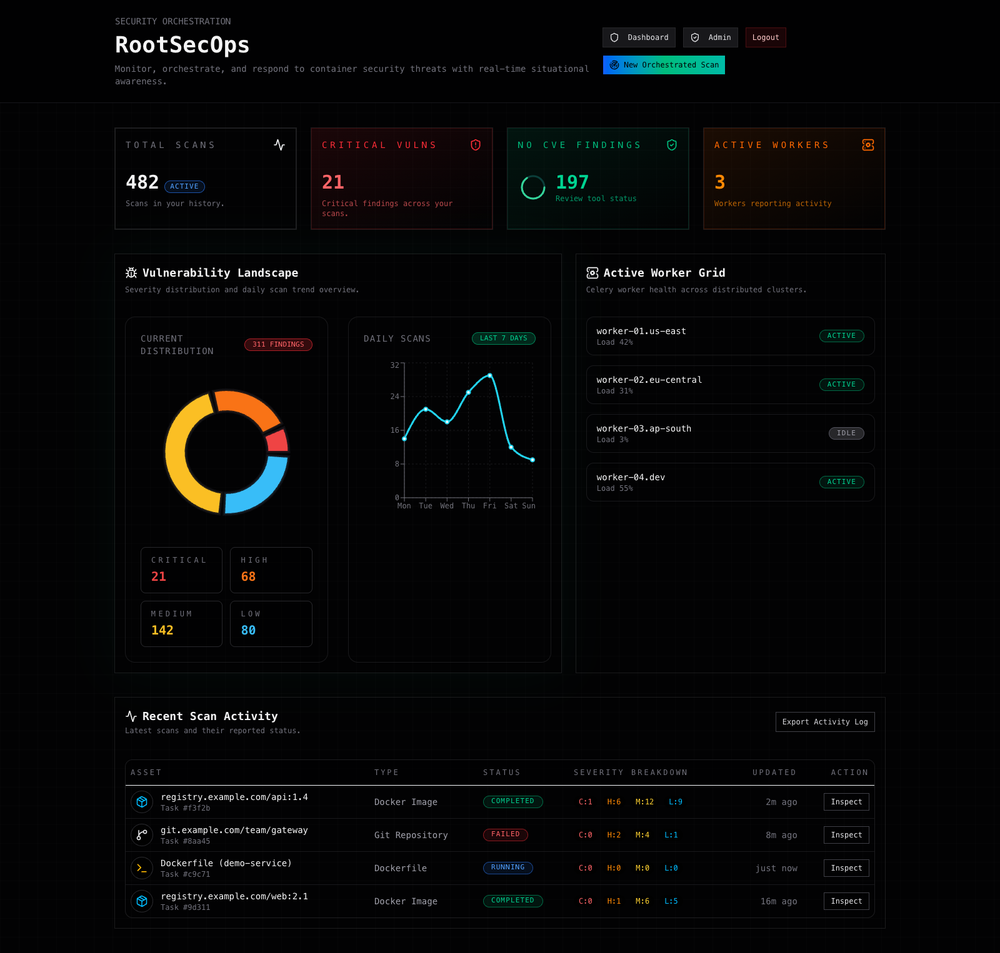
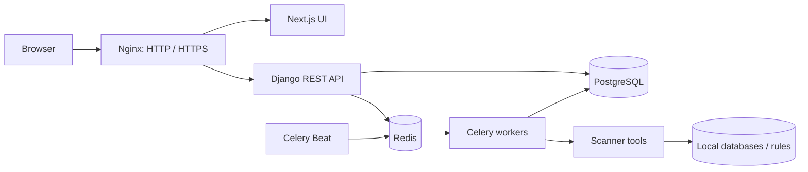

<div align="center">

# RootSecOps

**Multi-scanner security orchestration for DevSecOps.**

Container images. Git repositories. Dockerfiles. Uploaded files.<br>
One workflow to launch scans, inspect findings, and manage your tools.


[](LICENSE)

[Quick Start](#quick-start) · [Deployment](DEPLOY_UBUNTU.md) · [Architecture](docs/README.md) · [Contributing](CONTRIBUTING.md)

</div>



*Actual RootSecOps interface with synthetic demonstration data. The numbers
above are not benchmark results or evidence of a production deployment.*

## Why RootSecOps?

Security tools answer different questions. RootSecOps brings their execution
and results into a single workspace, while preserving the detail you need to
understand what each scanner actually found.

- **Start from the artifact.** Submit an image reference, repository URL,
  Dockerfile, or file for the matching analysis pipeline.
- **Investigate in one place.** Review vulnerabilities, exposed secrets,
  configuration findings, malware signatures, metadata, and SBOM components.
- **See the execution.** Follow progress, per-tool status, logs, and scan history.
- **Control the toolchain.** Manage scanner activation, configuration, database
  maintenance, and user access through the admin interface.
- **Own the deployment.** Django + Celery, Next.js, PostgreSQL, and Redis.
  No Elasticsearch, Logstash, or Kibana dependency.

## Scanner coverage

These are integrations, not a claim that every tool is installed or healthy.
Check tool status and provision the required databases before scanning.

| Analysis | Integrations | Operational notes |
| --- | --- | --- |
| Packages & vulnerabilities | Syft, Trivy, Grype, OSV-Scanner | Trivy uses preloaded vulnerability and Java databases. Grype auto-update is disabled in Compose. OSV may query online services. |
| Secrets | Gitleaks, TruffleHog | TruffleHog credential verification is disabled. Treat raw findings as sensitive. |
| Dockerfile & infrastructure | Hadolint, Checkov, KICS | KICS additionally needs its matching query assets. |
| Malware & rules | ClamAV, YARA | Requires current signatures and active, compatible rules. |
| Metadata & licenses | ExifTool, pdfinfo, Grant | Applicability depends on artifact type. |
| External integrations | Anchore, Clair | Optional adapters; their CLIs and external services are not provisioned by this stack. |

Image filesystem scans additionally need explicitly enabled Docker access.
A job can finish with failed or skipped tools: **review the logs and tool
statuses before interpreting zero findings as a clean result.**

## Quick start

Requires Docker Engine with Compose v2, Python 3, and network access for the
initial image/tool/database downloads. Run on a dedicated machine with enough
disk space for scanner databases and extracted images.

From the repository root:

```sh
python3 scripts/configure.py \
  --front-domain rootsecops.test \
  --api-domain api.rootsecops.test

docker compose --profile bundled-gateway up -d --build
bash scripts/update-databases.sh
```

The setup command creates a private `.env` with random application, database,
and administrator secrets. Open it locally to review the generated
`ADMIN_PASSWORD`; do not paste it into issues. Existing `.env` files are never
overwritten. Initial builds and database downloads can take several minutes.

Add both names to the hosts file **on the computer running your browser**,
using your Docker host's IP. For a local installation:

```text
127.0.0.1 rootsecops.test api.rootsecops.test
```

Open **https://rootsecops.test/login** and sign in with the configured
administrator. The bundled gateway creates a self-signed certificate for both
names; trust it on the client for both UI and API requests. HTTP also works on
trusted test networks, but sends credentials and tokens without encryption.

The default stack intentionally has **no Docker socket mount**. Before image
filesystem scanning, read the [opt-in Docker access instructions](DEPLOY_UBUNTU.md#image-filesystem-scanning).
Provision ClamAV/YARA separately and disable tools you have not configured.

Already running Nginx on Ubuntu? Do not start the bundled gateway.
Follow [host Nginx deployment](DEPLOY_UBUNTU.md#host-nginx) instead.

## How it fits together



Public domains come from `.env`. The browser calls
`//API_DOMAIN/api/v1`, using the same protocol as the UI.
An API domain change requires rebuilding the frontend.

## Explore the project

| Resource | What you will find |
| --- | --- |
| [Ubuntu deployment](DEPLOY_UBUNTU.md) | Domains, hosts files, Nginx, certificates, Docker access, databases, troubleshooting |
| [Architecture & API](docs/README.md) | Components, pipeline, endpoints, repository layout |
| [Backend](backend/README.md) / [Frontend](frontend/README.md) | Local development and checks |
| [File analysis](FILE_UPLOAD_GUIDE.md) | Upload behavior and static-analysis boundaries |
| [Security policy](SECURITY.md) | Reporting vulnerabilities and deployment risks |
| [Contributing](CONTRIBUTING.md) | Focused changes, tests, and pull requests |

## Project status

RootSecOps is an evolving project for controlled, trusted deployments.
It is not a public malware-submission service, an execution sandbox, or a
replacement for security review. Automated tests cover application behavior;
scanner availability, database freshness, and real-world coverage must be
validated in your environment.

The CI workflow runs backend tests, frontend lint/build, configuration checks,
and a secret scan. External scanner end-to-end validation is separate.

## Author & license

Created and maintained by **[Arash Shahbazi](https://github.com/Rootast)**.

Using RootSecOps in research or a technical write-up? Citation metadata is
available in [CITATION.cff](CITATION.cff).

RootSecOps is released under the [MIT License](LICENSE).
When redistributing substantial portions, retain the copyright and license
notice. Third-party scanners, rules, databases, and dependencies retain their
own licenses; see [Acknowledgments](ACKNOWLEDGMENTS.md).

Found the project useful? A star, a reproducible issue, or a thoughtful
contribution helps it grow.
